# Fancier Chameleon Ultra GUI

A phone-first redesign of [Chameleon Ultra GUI](https://github.com/GameTec-live/ChameleonUltraGUI):
the same app for the Chameleon Ultra / Lite, with a calmer, simpler interface. Dark by default,
PCB gold accent, monospace only where the data is.

  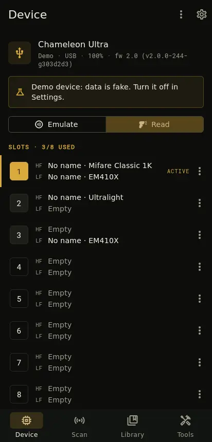
  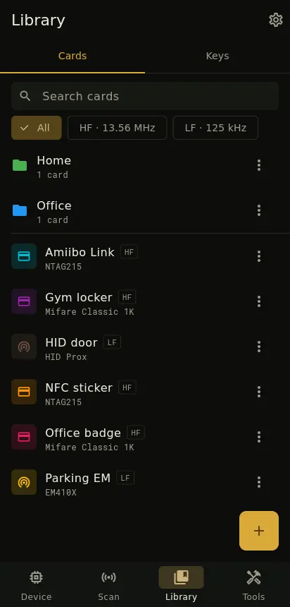
  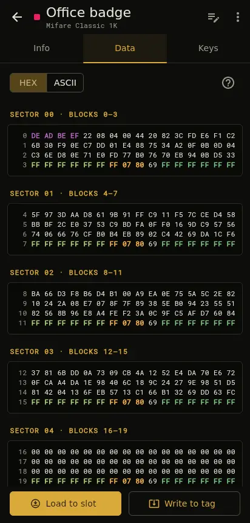
  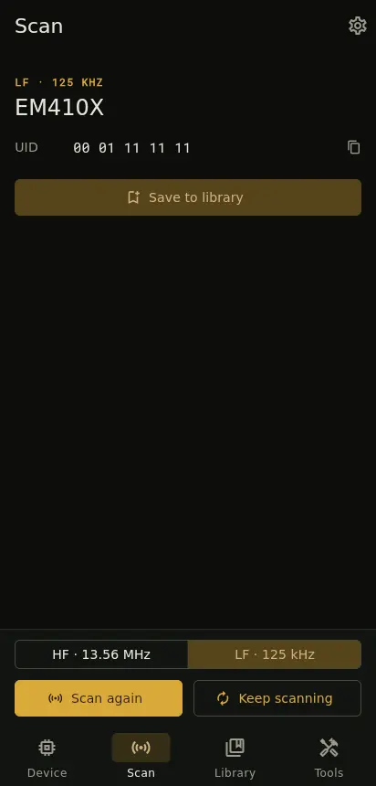

## Download

Signed Android APKs are on the **[Releases](https://github.com/nuc134r/FancierChameleonUltraGUI/releases/latest)** page.
Take `chameleon-<version>-arm64-v8a.apk` for most phones, or the universal `chameleon-<version>.apk`.
The app installs next to the original one (`io.nuc134r.chameleon`).

## What's different

Four tabs at the bottom instead of a side rail, pages instead of stacked dialogs, one ⋮ menu instead
of rows of icons.

### Device

Status at a glance, an Emulate | Read switch and all 8 slots in one list. Tap a slot to load a card
from the library, edit it, view its data or switch a side off. Device settings are a normal grouped
page.

  
  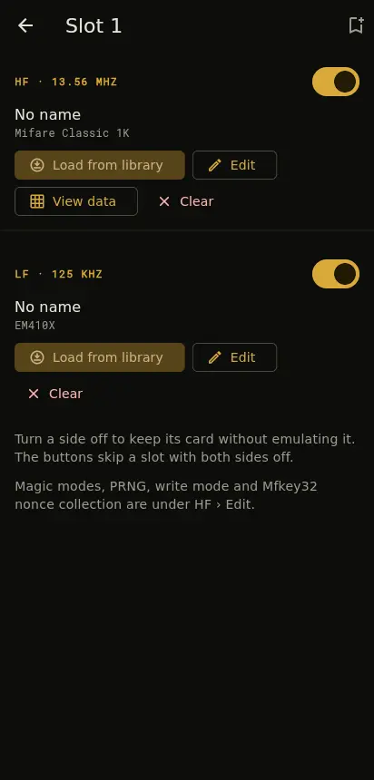
  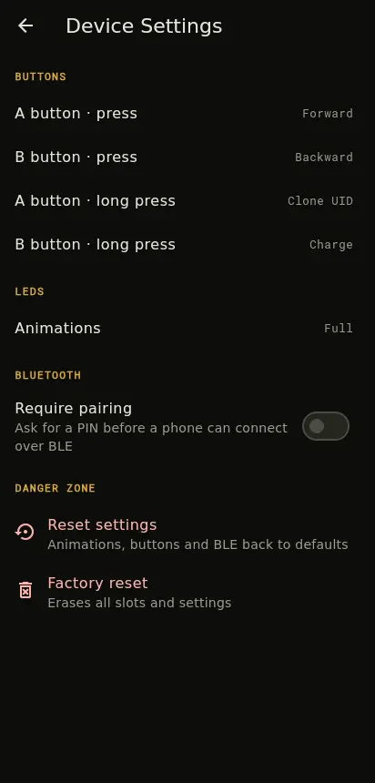

### Library

Cards and key dictionaries in two tabs, one full-height list each, with search, an HF/LF filter,
folders and long-press multi-select. A card opens on its own page: identifiers, the dump (hex or
ASCII), the keys of every sector and NDEF records, with **Load to slot** and **Write to tag** at the
bottom.

  
  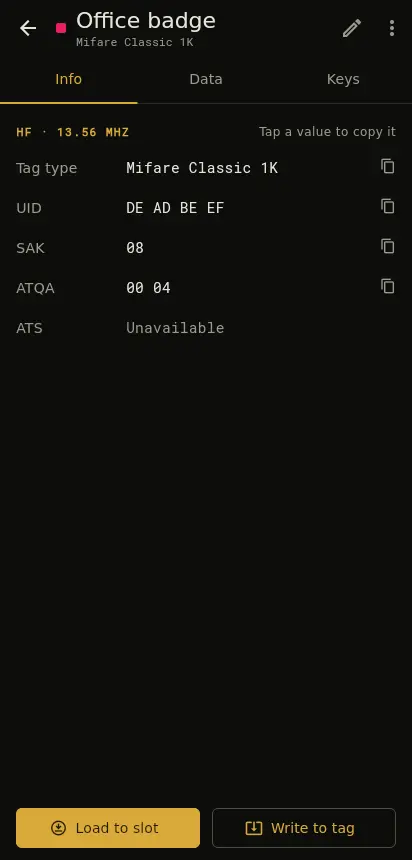
  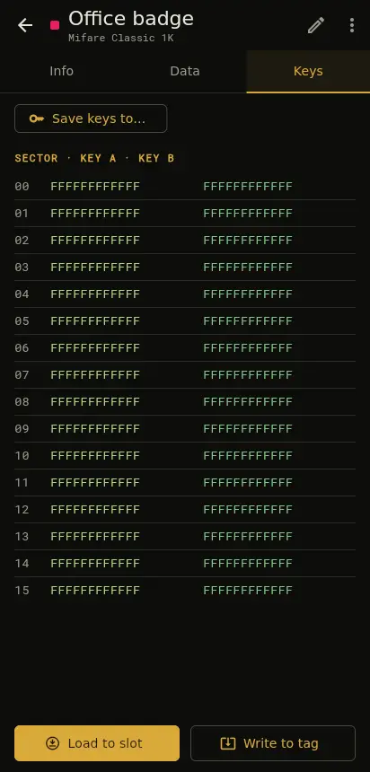
  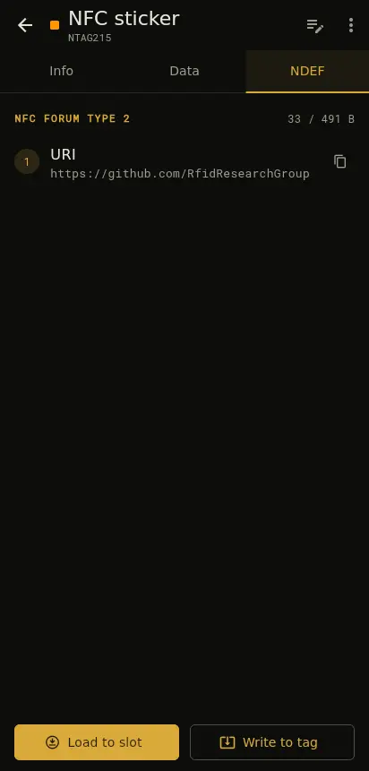

  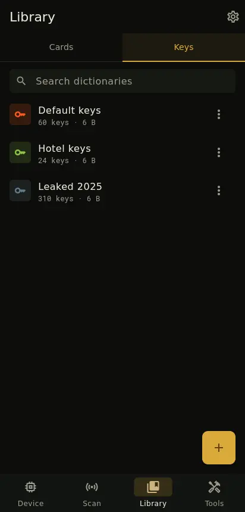
  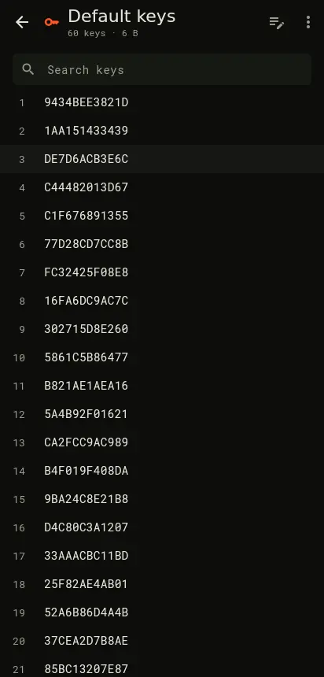

### Scan

Pick HF or LF, press Scan. The result shows the card type and identifiers you can tap to copy, and
saves to the library in one step.

  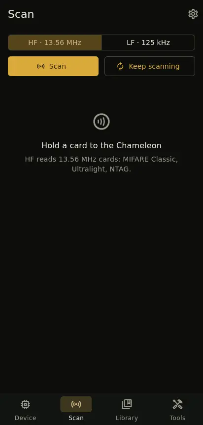
  

### Tools and Settings

  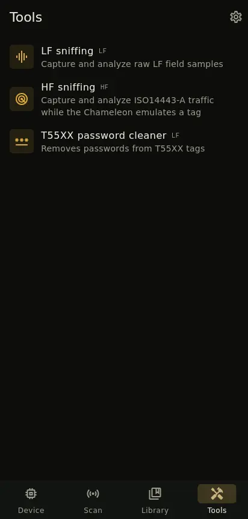
  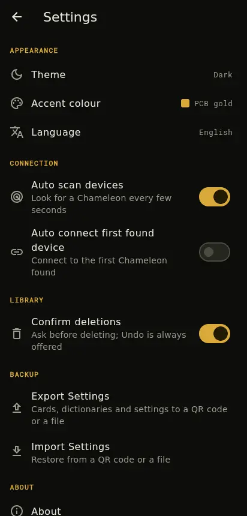

### Empty screens

No blank pages: every empty state says what to do next.

  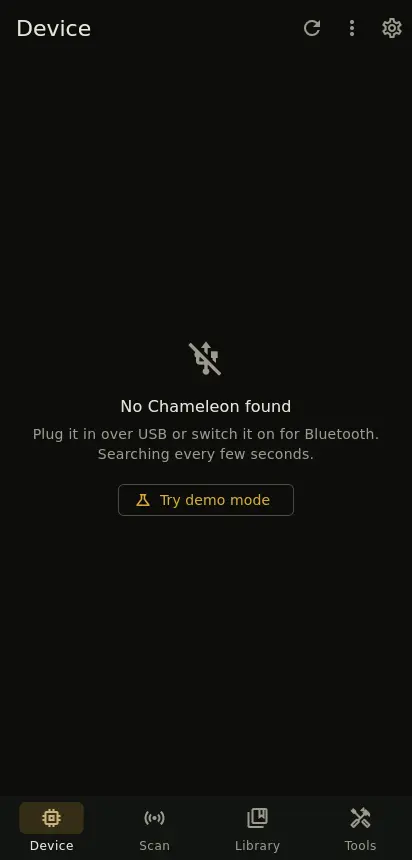
  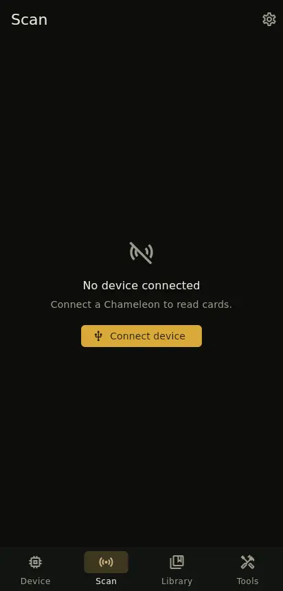
  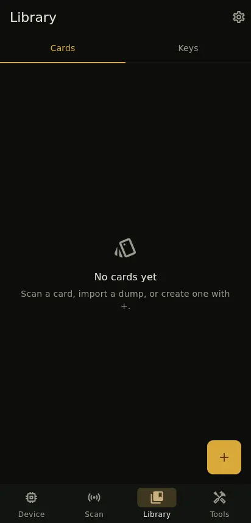
  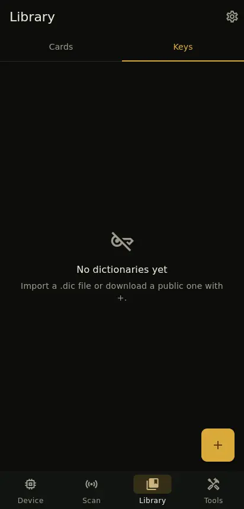

## About this fork

Built on top of the original app, which keeps doing the heavy lifting: device protocol, card
reading, key recovery, sniffing and firmware updates. This fork only changes the interface and
follows upstream closely. Screenshots use the built-in demo device, so names and values are fake.

Bugs in the redesigned screens belong here; everything else is best reported
[upstream](https://github.com/GameTec-live/ChameleonUltraGUI/issues).

For installation on other platforms, the full feature list, documentation and credits, see the
**[original README](https://github.com/GameTec-live/ChameleonUltraGUI#readme)**.
